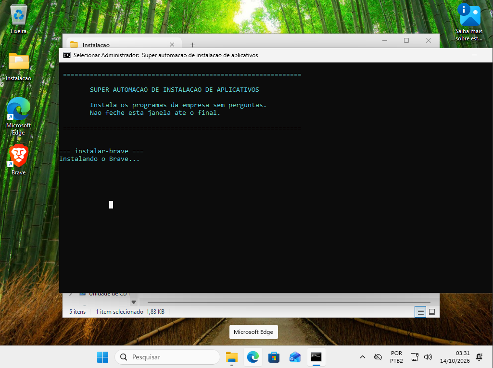

# Automação Windows 11

Provisionamento automatizado de equipamentos Windows com **Autounattend.xml**, **PowerShell** e **scripts .bat**. Um pendrive instala o Windows 11 Pro em português, deixa o sistema enxuto para uso corporativo (pensado para máquinas fracas) e entrega na área de trabalho uma pasta que instala os aplicativos da empresa com dois cliques.

Baseado em um projeto que desenvolvi por iniciativa própria no meu estágio de infraestrutura na Zallpy Digital. Esta é uma versão reconstruída para portfólio, sem nenhum dado interno da empresa. Como exemplo, ela instala o navegador Brave.

## Como funciona

1. **Instalação do Windows sem perguntas:** o instalador lê o `Autounattend.xml` e define idioma, teclado ABNT2, fuso horário, particionamento do disco e edição (Windows 11 Pro).
2. **Pasta na área de trabalho:** durante a instalação, a pasta `instalacao` do pendrive é copiada para a área de trabalho de todos os usuários.
3. **Windows enxuto:** ainda durante a instalação, antes de existir qualquer usuário, o `otimizar-windows.ps1` remove os apps e recursos inúteis para o trabalho (veja abaixo).
4. **Direto para a área de trabalho:** as telas da configuração inicial são puladas e o Windows entra sozinho, uma única vez, numa conta temporária **"Tecnico"**. Um aviso explica os próximos passos.
5. **Aplicativos com dois cliques:** o técnico abre a pasta **Instalacao** e dá dois cliques em **`INSTALAR.bat`**. Ele pede permissão de administrador sozinho, instala os programas sem perguntas e mostra o resultado na tela.
6. **Conta definitiva:** o técnico cria a conta de administrador definitiva e apaga a conta temporária.

## Demonstração

Windows recém-instalado pela automação, com a pasta **Instalacao** na área de trabalho e o `INSTALAR.bat` em execução (teste em máquina virtual no VirtualBox):

<p align="center">
  
</p>

## Estrutura

```
Autounattend.xml                respostas da instalação do Windows
instalacao/                     vai para a área de trabalho da máquina
  INSTALAR.bat                  dois cliques: instala todos os programas da pasta apps
  otimizar-windows.ps1          deixa o Windows enxuto (roda sozinho durante a instalação)
  apps/
    instalar-brave.bat          instala o Brave para todos os usuários, sem perguntas
  instaladores/                 instaladores offline (não vão para o GitHub)
```

Para adicionar um programa, veja [Como adicionar outro programa](#como-adicionar-outro-programa).

## Windows enxuto para uso corporativo

Pensado para máquinas fracas: só fica o que serve para trabalhar.

**Removido:**
- **Jogos e Xbox:** Solitaire, Xbox, Game Bar e gravação de jogos em segundo plano.
- **Apps de consumidor:** Notícias, Clima, Mapas, Clipchamp, Vincular ao Celular e integração com o celular pessoal, Pessoas, Dicas, Hub de Comentários, Obter Ajuda, Mail e Calendário antigos, Teams pessoal, Dev Home, Copilot, Cortana, o atalho "Microsoft 365 (Office)" e o "Novo Outlook".
- **Propaganda e sugestões:** apps que se instalam sozinhos, sugestões no Iniciar, dicas, ID de anúncios e Widgets.
- **Recursos pesados:** transparência, animações, hibernação (libera no disco o tamanho da RAM), Recall e o Edge rodando em segundo plano.
- **Barra de tarefas:** só Explorador de Arquivos e Edge fixados (sai, por exemplo, o atalho que baixa o "Novo Outlook"), sem Widgets e Visão de Tarefas, pesquisa como ícone e sem sugestões da Bing.
- **Área de trabalho:** sem o Destaque do Windows ("Saiba mais sobre esta imagem").

**Mantido (útil no trabalho):** Edge, Loja, OneDrive, Assistência Rápida (suporte remoto), Calculadora, Bloco de Notas, Paint, Fotos, Ferramenta de Captura, Notas Autoadesivas, To Do, Terminal e Media Player.

**Também:** extensões de arquivo visíveis (ajuda o usuário a perceber golpes como `fatura.pdf.exe`), telemetria no mínimo permitido no Windows Pro e atualizações compartilhadas só pela rede local.

## Segurança: nenhuma senha no pendrive

Um pendrive de instalação pode ser perdido ou copiado, então ele **não guarda credenciais**:

- **Nenhuma senha no `Autounattend.xml`.** Para a instalação ir direto até a área de trabalho, o arquivo cria uma conta temporária **"Tecnico" sem senha**, com login automático uma única vez. Logo no primeiro login, ela passa a **exigir uma senha nova** (`net user Tecnico /logonpasswordchg:yes`), então não fica aberta depois. O técnico cria a conta de administrador definitiva e apaga a temporária.
- **Por que não "esconder" a senha?** O `Autounattend.xml` só aceita a senha em texto puro ou codificada em Base64, que qualquer pessoa reverte em segundos. Não existe opção de hash, porque o Windows precisa da senha original para criar a conta. E, no Windows, até o hash da senha é sensível: ele pode ser usado diretamente em ataques do tipo *pass-the-hash*.
- **Sem chave de ativação.** O arquivo usa apenas a chave genérica pública da Microsoft, que escolhe a edição mas não ativa o Windows. A ativação vem da licença gravada na placa-mãe ou do licenciamento da empresa.
- **Em produção**, a senha do administrador local deve ser gerenciada pelo **Windows LAPS** (senha única por máquina, guardada no Active Directory ou no Entra ID e trocada automaticamente).

## Como usar

1. **Crie o pendrive de instalação do Windows 11** normalmente, com a Ferramenta de Criação de Mídia da Microsoft ou com o Rufus.
   - No **Rufus**, quando aparecer a janela de personalização do Windows (remover requisitos, criar conta local etc.), **desmarque todas as opções**. Elas fazem o Rufus gerar um `Autounattend.xml` próprio, que entra em conflito com este.
2. **Baixe os instaladores dos programas.** Este repositório não traz os instaladores (são arquivos grandes e de outras empresas). Para o exemplo do Brave, baixe o `BraveBrowserStandaloneSilentSetup.exe` no [GitHub oficial do Brave](https://github.com/brave/brave-browser/releases) (versão mais recente, em "Assets").
3. **Monte o pendrive.** Na **raiz** do pendrive, ao lado dos arquivos do Windows, ficam só **duas coisas** deste projeto: o arquivo `Autounattend.xml` e a pasta `instalacao`. A pasta `instaladores` vai **dentro** da pasta `instalacao`, e não ao lado do XML. O pendrive completo fica assim:

   ```
   PENDRIVE (E:)
   ├── boot\  efi\  sources\  setup.exe ...      (do instalador do Windows, não mexer)
   │
   ├── Autounattend.xml                          ← deste projeto, na raiz
   └── instalacao\                               ← deste projeto, na raiz
       ├── INSTALAR.bat                          ← já vem no projeto
       ├── otimizar-windows.ps1                  ← já vem no projeto
       ├── apps\
       │   └── instalar-brave.bat                ← já vem no projeto (um script por programa)
       └── instaladores\
           ├── LEIA-ME.txt                       ← já vem no projeto
           └── BraveBrowserStandaloneSilentSetup.exe   ← VOCÊ baixa e coloca aqui
   ```

   | Pasta | O que tem dentro | De onde vem |
   |---|---|---|
   | `instalacao\apps` | Um script `instalar-<programa>.bat` para cada programa | Deste repositório |
   | `instalacao\instaladores` | O instalador **offline** de cada programa, com o **nome exato** que o script espera | Você baixa do site oficial de cada programa |

   O instalador do Windows procura o `Autounattend.xml` sozinho na raiz do pendrive, e a cópia procura a pasta `instalacao` na raiz de qualquer unidade.
4. **Inicie a máquina pelo pendrive** (menu de boot da placa-mãe) e espere chegar na área de trabalho.
5. **Abra a pasta Instalacao** na área de trabalho e dê dois cliques em **`INSTALAR.bat`**.

### Como adicionar outro programa

Cada programa precisa de **duas coisas**: o **instalador** na pasta `instaladores` e um **script** na pasta `apps`.

1. Baixe o instalador **offline** (que traz o programa inteiro, sem precisar de internet) do site oficial e coloque em `instalacao\instaladores`.
2. Descubra o parâmetro de **instalação silenciosa** dele (sem janelas). Os mais comuns: `/S`, `/silent`, `/quiet` ou, para arquivos `.msi`, `msiexec /i arquivo.msi /qn`.
3. Copie o `instalar-brave.bat`, renomeie (por exemplo, `instalar-7zip.bat`) e ajuste três linhas: o nome do arquivo do instalador, o caminho onde o programa fica depois de instalado e o comando de instalação. Exemplo para o 7-Zip (instalador `.msi`):

   ```bat
   set "ARQUIVO=7z-x64.msi"
   set "BRAVE_EXE=%ProgramFiles%\7-Zip\7zFM.exe"
   msiexec /i "%~dp0..\instaladores\%ARQUIVO%" /qn /norestart
   ```

   No exemplo, a variável continua com o nome `BRAVE_EXE` só para você trocar o mínimo possível. Se quiser, renomeie para `PROGRAMA_EXE`, mas troque em **todas** as linhas do script onde ela aparece.

O `INSTALAR.bat` encontra sozinho todos os `instalar-*.bat` da pasta `apps` e roda em ordem alfabética.

> **Atenção:** o `Autounattend.xml` **apaga todo o disco 0** da máquina. Teste antes numa máquina virtual (Hyper-V ou VirtualBox).

Logs: `C:\Windows\Temp\otimizacao.log` (otimização) e `instalacao.log` dentro da pasta Instalacao (programas).

## Tecnologias

Windows 11 · Autounattend.xml · PowerShell · Batch Script · Automação
